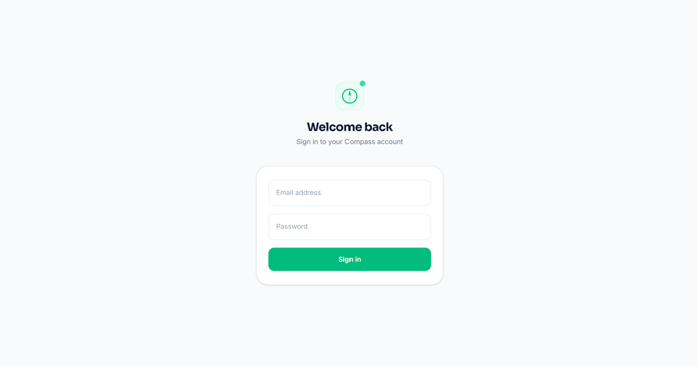
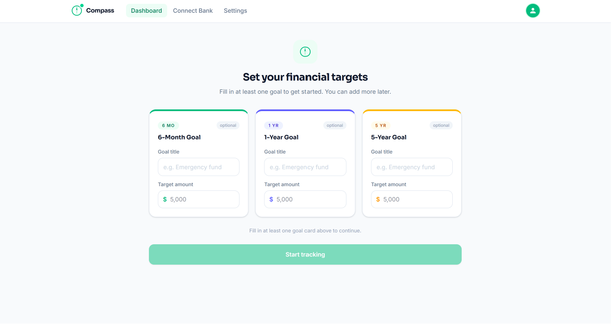
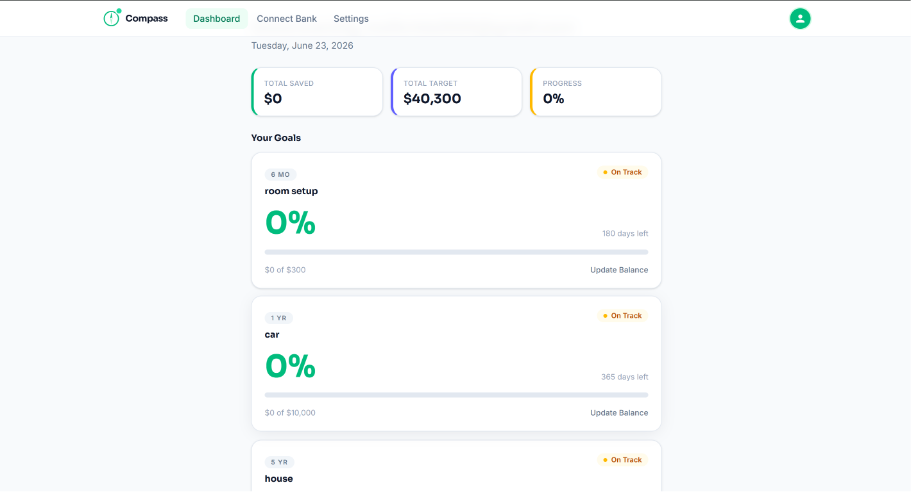
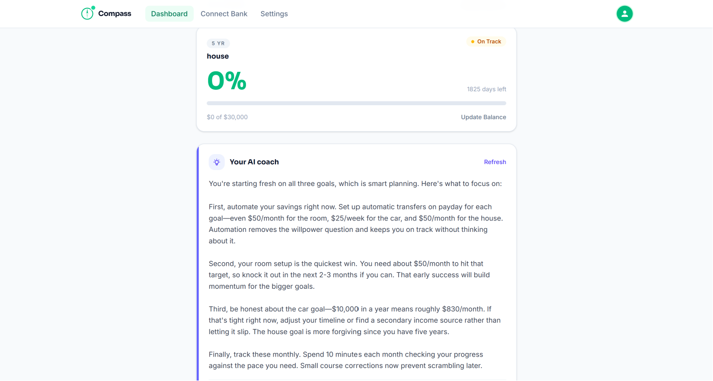
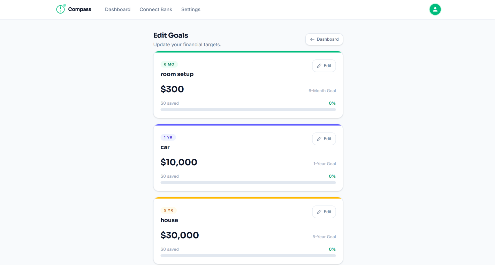
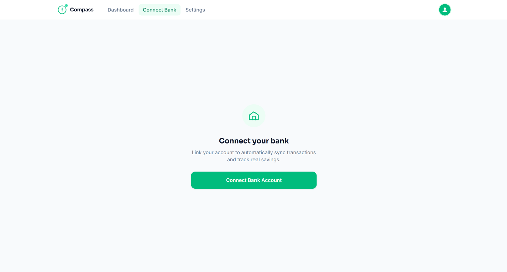
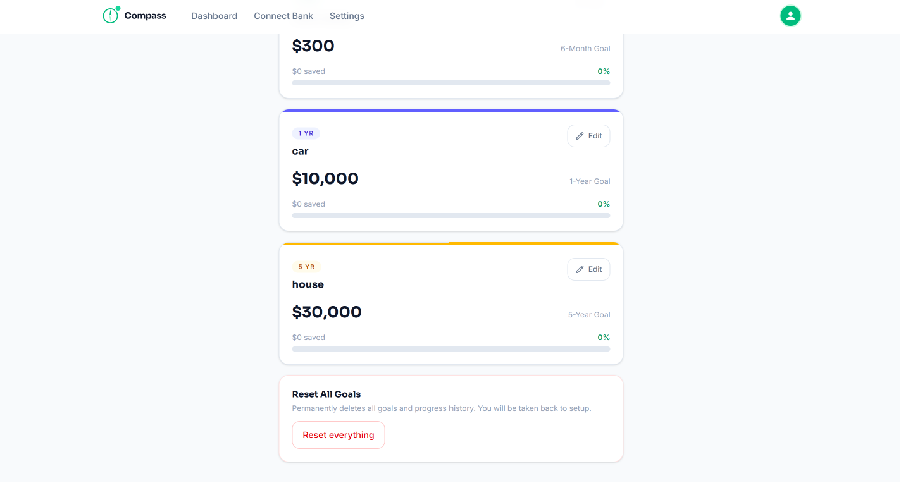
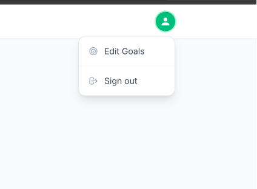
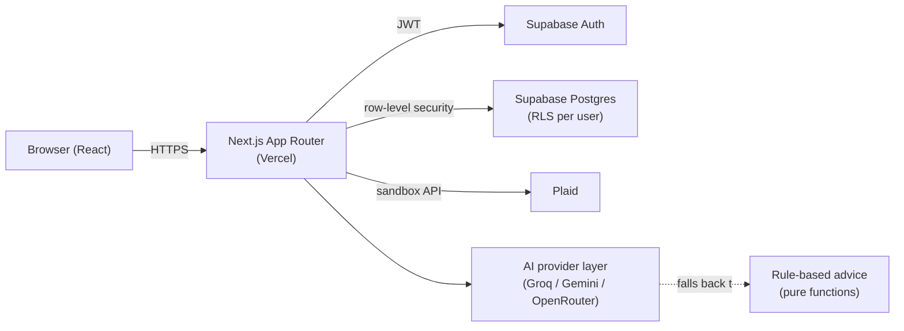

# Compass

AI-assisted savings goal tracker with real bank sync, built on a fully free stack.

[](https://compass-phi-one.vercel.app)
[](https://github.com/ridamalik26/compass/actions/workflows/ci.yml)
[](https://compass-phi-one.vercel.app)

Live app: [https://compass-phi-one.vercel.app](https://compass-phi-one.vercel.app)

## Why I built this

I wanted a project that was not another CRUD demo: real authentication, a real bank data
connection, and an AI feature that had to survive on a free-tier budget instead of an
unlimited API key. That constraint shaped most of the interesting decisions below, from the
caching and rate limiting on the AI layer to the rule-based fallback that keeps the coach
working when a provider is off or unavailable.

## Features

### Auth

- Email sign up with name, email and password, with a confirmation email when email
  confirmation is turned on in Supabase
- Continue with Google on the login and sign up pages
- Password reset by email (forgot password and reset password pages)
- Change email or password from the settings page
- Session expiry handling: an unexpected end of session redirects to `/login?expired=1` with a
  clear notice, while an intentional sign out does not

### Goals and Dashboard

- Up to three savings goals (6-month, 1-year, 5-year) with target amounts and titles
- Live dashboard with per-goal progress, pace status (Ahead, On Track, Behind), and a weekly
  change figure
- Flexible balance entry: add money, withdraw, or set an exact balance, with a live preview of
  the resulting balance before saving
- Edit or reset goals at any time

### AI Coach

- Tips tailored to each goal's actual pace, generated through a swappable free AI provider
  (Groq, Gemini or OpenRouter) behind one adapter
- Rule-based fallback that produces the same kind of tip from the pace numbers alone, used when
  AI is off, unconfigured, over quota, or the request fails
- Per-user and global daily quotas, plus a cache keyed to the current goal numbers, so the same
  AI call is never repeated for unchanged goals

### Bank connect

- Plaid sandbox integration via Plaid Link to connect a bank account
- Idempotent, paginated transaction sync: re-running a sync never double-counts a transaction
  already applied to goal progress
- Net savings from synced transactions are applied straight to goal balances

## Screenshots

### Login


### Dashboard


### Savings chart


### AI Recommendations


### Edit Goals


### Connect Bank via Plaid


### Reset Goals


### Sign Out


## Architecture



## Engineering decisions

- **Row level security everywhere, service role only for Plaid tokens.** Every table a user's
  browser can reach (`goals`, `goal_progress`, `goal_progress_history`, `transactions`) has RLS
  policies scoped to `auth.uid()`. `plaid_tokens` has RLS enabled with no policies at all, so it
  is reachable only through the service-role client, which is used solely for that table and
  only after the caller's JWT has already been verified.
- **The AI layer is cached, rate-limited, and never the single point of failure.** A database
  RPC enforces a per-user and a global daily quota before any provider call is made. A result is
  cached by a hash of the goal numbers, so unchanged goals reuse the same advice instead of
  spending quota again. If the provider is unset, out of quota, or the request fails, the app
  falls back to deterministic, rule-based tips built from the same pace numbers shown on the
  dashboard, so the coach never goes blank.
- **Free-tier-only by design.** Supabase, Vercel, Plaid sandbox and the AI providers (Groq,
  Gemini, OpenRouter) all run on their free tiers. The AI adapter is one OpenAI-compatible
  client so switching providers, or turning AI off entirely (`AI_PROVIDER=none`), is a single
  environment variable.
- **Three balance entry modes instead of one.** The dashboard lets a user add, withdraw, or set
  an exact balance rather than only incrementing a number, because that is closer to how people
  actually track savings, and all three are parsed and validated in integer cents to avoid float
  drift.
- **Weekly change is computed from history, not stored as a running total.** Each save writes an
  append-only snapshot to `goal_progress_history`. The dashboard's weekly change is the
  difference between the current balance and the last snapshot at or before seven days ago, so
  it stays correct even if balances are edited out of order.
- **Session expiry is treated as a distinct state from signing out.** A small client-side
  watcher listens for Supabase's `SIGNED_OUT` auth event and redirects to a login page with an
  expiry notice, unless a flag set just before an intentional sign out says otherwise.

## Tech Stack

| Layer | Choice |
| --- | --- |
| Framework | Next.js 16 (App Router), TypeScript |
| Styling | Tailwind CSS |
| Database / Auth | Supabase (Postgres with RLS, Supabase Auth) |
| Bank data | Plaid SDK (sandbox) |
| AI | Groq, Gemini or OpenRouter through one OpenAI-compatible adapter, with a rule-based fallback |
| Charts | Recharts |
| Validation | Zod |
| Testing | Vitest |
| Hosting | Vercel |
| CI | GitHub Actions |

## Project Structure

```
app/                   Next.js App Router pages and API routes
  api/plaid/            Plaid link-token, token exchange and sync routes
  api/recommendations/  AI coach endpoint
  dashboard/, goals/, connect-bank/, settings/, login/, signup/, ...
components/            Shared client components (Navbar, Toast, AuthWatcher, ...)
lib/                   Server and shared logic
  ai/                   Provider adapter, rule-based fallback, recommendation flow
  pace.ts, balance.ts, savings.ts, money.ts, plaid-sync.ts
  supabase.ts, supabase-server.ts, supabase-admin.ts
supabase/migrations/   SQL migrations, applied in order via the Supabase SQL editor
```

## Local Setup

1. Clone the repo
2. Run `npm install`
3. Copy `.env.local.example` to `.env.local` and fill in your keys

| Variable | Purpose |
| --- | --- |
| `NEXT_PUBLIC_SUPABASE_URL` | Supabase project URL, used by the browser and server clients |
| `NEXT_PUBLIC_SUPABASE_ANON_KEY` | Supabase anon key, used by the browser and server clients |
| `SUPABASE_SERVICE_ROLE_KEY` | Server-only key used solely for the `plaid_tokens` table |
| `PLAID_CLIENT_ID` | Plaid client ID (sandbox) |
| `PLAID_SECRET` | Plaid sandbox secret |
| `PLAID_ENV` | Plaid environment, `sandbox` |
| `AI_PROVIDER` | `groq`, `gemini`, `openrouter`, or `none` to disable AI and always use rule-based tips |
| `AI_API_KEY` | API key for the chosen AI provider |
| `AI_MODEL` | Optional override if a provider's default model is retired |

4. Run the SQL migrations in `/supabase/migrations/` in order via the Supabase SQL editor
5. Run `npm run dev`
6. Open `http://localhost:3000`

## Running the tests

```
npm test
```

This runs the Vitest suite covering `lib/money.ts`, `lib/pace.ts`, and the Plaid sync
idempotency helpers in `lib/plaid-sync.ts`.

## Authentication

Authentication uses Supabase Auth on the free plan.

- **Email sign up:** the sign up page collects name, email and password (minimum 8 characters).
  Supabase sends a confirmation link when email confirmation is on. If it is off, the user goes
  straight to the dashboard.
- **Google sign in:** enable the Google provider in Supabase (Authentication, Providers) with a
  free Google Cloud OAuth client. Add your site URL and `/dashboard` to the allowed redirect
  URLs.
- **Password reset:** the forgot password page emails a link to `/reset-password`, where the
  user sets a new password and is sent back to the login page.
- **Profiles:** a database trigger (migration `012_handle_new_user.sql`) creates the profile row
  for every new user, including Google users.
- **Session expiry:** a small watcher redirects to `/login?expired=1` when the session ends
  unexpectedly. Signing out on purpose does not show the notice.
- **Email limits:** the built-in Supabase email sender is heavily rate limited and may only
  deliver to your own team addresses. For public sign ups, add a free custom SMTP provider under
  Authentication, Emails.

## Demo account

<!-- Add a demo email/password here once you create one in Supabase. -->

## Roadmap

- [ ] Support more than three goals per user
- [ ] Multi-account Plaid support (currently one linked account per user)
- [ ] Email or push notifications when a goal falls behind pace
- [ ] Automated end-to-end tests for the auth and Plaid flows
